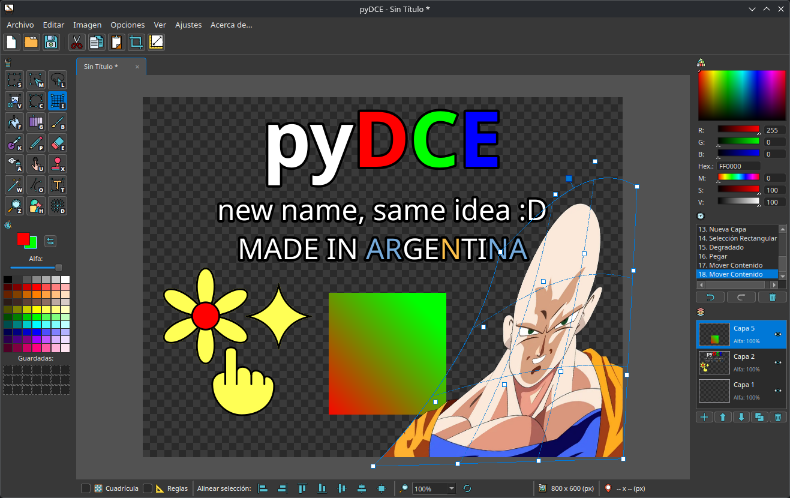

<p align="center">
  
</p>

<h1 align="center"><b>pyDCE</b>: <b>Py</b>thon <b>D</b>igital <b>C</b>anvas <b>E</b>ditor</h1>

<p align="center">
  <b>Un editor de imágenes liviano, potente y moderno para Linux inspirado en Paint.NET.</b>
</p>

<p align="center">
  <a href="https://github.com/adrianandin0/pyDCE/stargazers"></a>
  <a href="https://github.com/adrianandin0/pyDCE/issues"></a>
  <a href="https://github.com/adrianandin0/pyDCE/blob/main/LICENSE"></a>
  <a href="https://x.com/adrian_and_ino"></a>
</p>

<p align="center">
  <a href="README.md">English</a> | <b>Español</b> | <a href="README.pt.md">Português</a> | <a href="README.fr.md">Français</a> | <a href="README.zh-CN.md">简体中文 (zh-CN)</a>
</p>

<p align="center">
  
</p>

---

## Tabla de Contenidos
- [Acerca del Proyecto](#acerca-del-proyecto)
- [Características Principales](#características-principales)
- [Herramientas](#herramientas)
- [Detalles Técnicos](#detalles-técnicos)
- [Guía de Instalación](#guía-de-instalación)
  - [Instalación en Linux (Plataforma Principal)](#instalación-en-linux-plataforma-principal)
  - [Instalación Opcional en Windows](#instalación-opcional-en-windows)
  - [Instalación y Compilación en macOS](#instalación-y-compilación-en-macos)
  - [Ejecución Directa desde el Código Fuente](#ejecución-directa-desde-el-código-fuente)
- [Solución de Problemas](#solución-de-problemas)
- [Contribuir](#contribuir)
- [Autor y Contacto](#autor-y-contacto)
- [Créditos](#créditos)

---

## Acerca del Proyecto

**pyDCE**: **Py**thon **D**igital **C**anvas **E**ditor es un editor de imágenes desarrollado con **Python 3** y **PyQt6** como homenaje a **Paint.NET**. Nació para cubrir la ausencia de una versión oficial en Linux, ofreciendo una experiencia rápida, fluida y familiar para usuarios de **Linux**. Aunque Python permite ejecutarlo también en Windows y macOS, su diseño y desarrollo están orientados principalmente a la comunidad Linux.

---

## Características Principales

- **Interfaz Moderna**: Temas claro y oscuro (con patrón de transparencia en cuadrícula adaptado al tema).
- **Soporte Multilingüe (i18n)**: Español, Inglés, Portugués, Francés y Chino Simplificado (`zh-CN`), con cambio en tiempo real desde *Opciones → Preferencias de usuario* (sin reiniciar).
- **Capas**: Miniaturas, visibilidad, opacidad, reordenamiento, duplicación y combinación.
- **Historial Completo (Deshacer / Rehacer)**: Instantáneas inmutables del documento optimizadas con Copy-on-Write y límite de memoria configurable.
- **Formato Nativo `.pnn`**: Formato de proyecto con soporte de capas y transparencia; asociación MIME automática para abrir con doble clic.
- **Atajos de Teclado Personalizables**: Reasigna teclas rápidas para todas las herramientas desde *Opciones → Atajos de teclado…*.
- **Impresión y Exportación a PDF**: Impresión directa del lienzo y generación de documentos PDF.
- **Búsqueda e Inserción de Imágenes Online**: Busca e inserta imágenes directamente desde Pexels, Unsplash, Pixabay, Wikimedia Commons, entre otros.
- **Formatos de Exportación**: PNG, JPG, BMP, WEBP, GIF, TIFF, ICO, TGA, PDF y `.pnn` nativo.
- **Ajustes de Imagen y Color**: Exposición, temperatura y tinte, niveles (puntos blanco/negro de entrada y salida), sepia, posterizado, brillo, contraste, tono/saturación, invertir y blanco y negro.
- **Panel de Color Avanzado**: Selector 2D de espectro, deslizadores RGB/HSV y paleta de colores guardados.

<p align="center">
  
</p>

---

## Herramientas

### Selección
| Herramienta | Descripción |
|---|---|
| Selección rectangular | Selecciona áreas rectangulares |
| Selección elíptica | Selecciona áreas elípticas |
| Selección libre (Lazo) | Selección de contorno a mano alzada |
| Varita mágica | Selección de áreas según tolerancia de color |
| Mover contenido | Mueve los píxeles de la selección |
| Mover selección | Mueve únicamente el contorno de selección |
| Transformar | Escala, rota y ajusta mediante manejadores de control |

### Dibujo y Pintura
| Herramienta | Descripción |
|---|---|
| Lápiz | Dibujo preciso de píxeles; modo realista con control de dureza y polvo |
| Pincel | Grosor personalizable, suavizado y forma de punta |
| Goma de borrar | Borrado con tamaño y forma configurables |
| Aerosol | Pintura en aerosol con densidad y efecto de goteo |
| Difuminar (Dedo) | Arrastra y mezcla píxeles sobre el lienzo |
| Estampa | Toma una muestra de referencia y duplica píxeles en otra zona |
| Balde de pintura | Rellena áreas según tolerancia de color |
| Degradado | Relleno con degradados lineales o radiales |
| Línea / Curvas | Dibuja líneas y curvas con manejadores Bézier |
| Formas | Formas geométricas (Rectángulos, Elipses, Estrellas, Polígonos, Sol, Chispa, Rombo, etc.) |
| Texto | Agrega texto con selección de fuente, borde, resplandor y sombra |
| Cuentagotas | Toma muestras de color directamente del lienzo |
| Zoom | Acerca/aleja o selecciona un área específica para enfocar |

<p align="center">
  
</p>

---

## Detalles Técnicos

### Arquitectura (v2)

pyDCE está estructurado en componentes modulares:

| Módulo | Función |
|--------|---------|
| `core/canvas.py` | Widget principal del lienzo (`CanvasWidget`): estado del documento, historial y operaciones de archivo/imagen |
| `core/canvas_input_handler.py` | Mapeo y despacho de eventos de ratón (canal único de entrada) |
| `core/canvas_renderer.py` | Composición de capas, patrón de transparencia y renderizado de cuadrícula de píxeles |
| `core/opengl_canvas.py` | Widget opcional de lienzo acelerado por OpenGL (`QOpenGLWidget`) |
| `core/layers.py` | Gestor de capas, caché de composición y manejo de Copy-on-Write |
| `core/history.py` | Pila de historial Deshacer / Rehacer y control de memoria RAM |
| `core/selection.py` | Motor de selección y contenido flotante |
| `core/stroke_smoother.py` | Suavizado de trazos (interpolación Bézier / filtrado) |
| `core/theme.py` | Gestor de temas Claro/Oscuro y paleta del patrón de transparencia |
| `core/pnn_format.py` | Carga y guardado del formato de proyecto nativo `.pnn` |
| `core/pexels.py` + `gui/dialogo_pexels.py` | Motor de búsqueda de imágenes online y diálogo de selección |
| `tools/` | Clases individuales de herramientas con interfaz común (`mouse_press`, `move`, `release`) |
| `gui/` | Paneles de interfaz, diálogos, barra de estado y constructores de diseño |

### Comportamientos Clave del Sistema

- **Pipeline de Entrada Unificado**: Todos los eventos del ratón en el lienzo pasan por `CanvasInputHandler`, que gestiona el mapeo de coordenadas (zoom/desplazamiento), aplica Copy-on-Write solo en herramientas de edición y registra estados en el historial cuando corresponde.
- **Historial Copy-on-Write**: Las instantáneas comparten las capas no modificadas mediante Copy-on-Write nativo de Qt, evitando copias innecesarias y reduciendo el consumo de RAM.
- **Consistencia de Temas**: El fondo de transparencia del lienzo, las miniaturas de capas y las tarjetas de vista previa online comparten una única definición en `ThemeManager.colores_checkerboard()`.
- **Gestión de Capas**: Mezcla por opacidad, capas temporales de trazo y superposiciones flotantes; actualización dinámica de miniaturas al cambiar de tema.
- **Dependencias Principales**: PyQt6, NumPy, OpenCV, Pillow, Requests (búsqueda online). Empaquetado opcional con PyInstaller.

### Plataformas

- **Linux** (Debian/Ubuntu, Fedora, Arch Linux, openSUSE y derivadas)
- **Windows** (soporte opcional con instaladores `.bat` e Inno Setup)
- **macOS** (11.0 Big Sur o superior en Apple Silicon e Intel)

<p align="center">
  
</p>

---

## Guía de Instalación

Antes de ejecutar los instaladores o compilar desde el código fuente, asegúrate de tener **Python 3** y **Git** instalados en tu sistema.

---

### Instalación en Linux (Plataforma Principal)

#### Paso 1: Instalar Python, Git y Dependencias del Sistema
Abre tu terminal y ejecuta el comando correspondiente a tu distribución:

- **Debian / Ubuntu / Linux Mint / Pop!_OS**:
  ```bash
  sudo apt update
  sudo apt install -y python3 python3-pip python3-venv git build-essential libxcb-cursor0 libegl1 libgl1 libdbus-1-3
  ```

- **Fedora / RedHat / RHEL / CentOS / AlmaLinux**:
  ```bash
  sudo dnf install -y python3 python3-pip git gcc gcc-c++ libxcb mesa-libEGL mesa-libGL dbus-libs
  ```

- **Arch Linux / Manjaro / EndeavourOS**:
  ```bash
  sudo pacman -Sy --needed --noconfirm python python-pip git base-devel libxcb xcb-util xcb-util-cursor xcb-util-image xcb-util-keysyms xcb-util-renderutil xcb-util-wm libegl libgl dbus
  ```

- **openSUSE / SUSE Linux Enterprise**:
  ```bash
  sudo zypper install -y python3 python3-pip git gcc libxcb-cursor0 libEGL1 libGL1 libdbus-1-3
  ```

#### Paso 2: Clonar el Repositorio
```bash
git clone https://github.com/adrianandin0/pyDCE.git
cd pyDCE
```

#### Paso 3: Ejecutar el Instalador Automático (`install.sh`)
El script `install.sh` crea el entorno virtual, instala las dependencias, compila el binario con PyInstaller y genera los accesos directos en el escritorio:
```bash
sudo ./install.sh
```
Selecciona tu idioma preferido (`01 - Español` / `02 - English` / `03 - Português` / `04 - Français` / `05 - 简体中文 (zh-CN)`). Al finalizar, inicia pyDCE desde el menú de aplicaciones o ejecutando:
```bash
pydce
```

---

### Instalación Opcional en Windows

> [!NOTE]
> **Nota para usuarios de Windows**:  
> Si utilizas Windows, te recomendamos usar la aplicación oficial **[Paint.NET](https://www.getpaint.net/)**. pyDCE fue creado como un homenaje dedicado a la comunidad Linux. Aunque Python permite ejecutarlo en Windows, alentamos a apoyar el software original en su plataforma nativa.

#### Paso 1: Instalar Python y Git mediante Winget
Abre el **Símbolo del sistema (CMD)** o **PowerShell** y ejecuta:
```cmd
winget install --id Python.Python.3.12 -e & winget install --id Git.Git -e
```
*IMPORTANTE*: Cierra la terminal actual y abre una nueva al finalizar la instalación para actualizar las variables de entorno.

*(Alternativa sin Winget)*: Descarga Python manualmente desde [python.org/downloads](https://www.python.org/downloads/) (asegúrate de marcar **"Add python.exe to PATH"**) y Git desde [git-scm.com](https://git-scm.com/).

#### Paso 2: Clonar el Repositorio
En tu **nueva ventana de terminal**, ejecuta:
```cmd
git clone https://github.com/adrianandin0/pyDCE.git
cd pyDCE
```

#### Paso 3: Configurar Entorno Virtual y Dependencias
```cmd
python -m venv venv
call venv\Scripts\activate.bat
pip install --upgrade pip
pip install -r requirements_windows.txt pyinstaller
```

#### Paso 4: Ejecutar el Instalador de Windows (`install.bat`)
```cmd
install.bat
```
Compila el ejecutable nativo, lo instala en `%LOCALAPPDATA%\pyDCE` y crea accesos directos en el **Escritorio** y en el **Menú Inicio**.

---

### Instalación y Compilación en macOS

pyDCE es compatible con macOS 11.0 (Big Sur) y versiones posteriores en Mac con Apple Silicon e Intel.

#### Aplicación Precompilada (.app / .zip / .dmg)
1. Descarga el archivo `pyDCE-*-macos.zip` o `pyDCE-*-macos.dmg` más reciente desde Releases.
2. Abre el DMG o descomprime el ZIP.
3. Arrastra `pyDCE.app` a `/Applications`.
4. Si macOS Gatekeeper indica que no se puede verificar el desarrollador:
   - Haz clic derecho sobre `pyDCE.app` y selecciona **Abrir**, o
   - Ejecuta en Terminal:
     ```bash
     xattr -cr /Applications/pyDCE.app
     ```

#### Compilar desde el Código Fuente en macOS
```bash
git clone https://github.com/adrianandin0/pyDCE.git
cd pyDCE
chmod +x build_macos.sh
./build_macos.sh
```
El script compila `dist_pkg/pyDCE.app`, aplica firma ad-hoc y genera `pyDCE-*-macos.zip` y `pyDCE-*-macos.dmg`.

---

### Ejecución Directa desde el Código Fuente

Si prefieres no compilar ni instalar paquetes en el sistema, ejecuta pyDCE directamente con Python (después de completar el Paso 1 de tu sistema operativo):

#### Linux:
```bash
git clone https://github.com/adrianandin0/pyDCE.git
cd pyDCE
python3 -m venv venv
source venv/bin/activate
pip install --upgrade pip
pip install -r requirements_linux.txt
python main.py
```

#### Windows:
```cmd
git clone https://github.com/adrianandin0/pyDCE.git
cd pyDCE
python -m venv venv
call venv\Scripts\activate.bat
pip install --upgrade pip
pip install -r requirements_windows.txt
python main.py
```

#### macOS:
```bash
git clone https://github.com/adrianandin0/pyDCE.git
cd pyDCE
python3 -m venv venv
source venv/bin/activate
pip install --upgrade pip
pip install -r requirements_macos.txt
python main.py
```

---

## Solución de Problemas

### 1. `python3: command not found` o `python no se reconoce como un comando`
- **Causa**: Python no está instalado o no fue agregado a la variable `PATH`.
- **Solución en Linux**: Completa el Paso 1 con `sudo apt install python3 python3-pip python3-venv` (o el equivalente de tu distribución).
- **Solución en Windows**: Ejecuta `winget install --id Python.Python.3.12 -e` y **reinicia tu terminal**.

### 2. `git no se reconoce`
- **Causa**: Git no está instalado o no se reinició la terminal tras instalarlo.
- **Solución**: Instala Git (`winget install --id Git.Git -e` en Windows o `sudo apt install git` en Linux) y **reinicia tu terminal**.

### 3. `pip: command not found`
- **Solución en Linux**: Instala pip con `sudo apt install python3-pip` (Debian/Ubuntu) o `sudo dnf install python3-pip` (Fedora).
- **Solución en Windows**: Ejecuta `python -m ensurepip --upgrade`.

### 4. Error `externally-managed-environment` en Linux Moderno (Debian 12+, Ubuntu 23.04+, Arch)
- **Causa**: Las distribuciones modernas impiden instalar paquetes con `pip` globalmente fuera de entornos virtuales.
- **Solución**: Utiliza siempre un entorno virtual (`python3 -m venv venv` y `source venv/bin/activate`) o ejecuta `sudo ./install.sh`, que administra el entorno automáticamente.

### 5. `pyinstaller: command not found`
- **Causa**: PyInstaller no está instalado en el entorno virtual activo.
- **Solución**: Activa tu entorno virtual y ejecuta `pip install pyinstaller`.

### 6. `winget no se reconoce` en Windows
- **Causa**: Versiones antiguas de Windows 10 sin App Installer.
- **Solución**: Descarga manualmente Python desde [python.org](https://www.python.org/downloads/) (marcando **"Add python.exe to PATH"**) y Git desde [git-scm.com](https://git-scm.com/).

---

## Contribuir

¡Las contribuciones, traducciones y reportes de errores son bienvenidos!

- **Reportar un error**: Abre un issue en [GitHub Issues](https://github.com/adrianandin0/pyDCE/issues).
- **Enviar código**: Haz un fork del repositorio, crea una rama y abre un Pull Request.

---

## Autor y Contacto

- **Desarrollador**: Adrian
- **X (Twitter)**: [@adrian_and_ino](https://x.com/adrian_and_ino)
- **GitHub**: [adrianandin0/pyDCE](https://github.com/adrianandin0/pyDCE)

Desarrollado en Python con asistencia de **Google Gemini** y **Google Antigravity**.

---

## Créditos

Agradecimiento especial a los creadores de íconos de Flaticon:

| Autor | Enlace |
|---|---|
| Flaticon | [flaticon.com](https://www.flaticon.com/) |
| Smashicons | [authors/smashicons](https://www.flaticon.com/authors/smashicons) |
| Magnific | [authors/magnific](https://www.flaticon.com/authors/magnific) |
| Pixel perfect | [authors/pixel-perfect](https://www.flaticon.com/authors/pixel-perfect) |

---

<p align="center">Si te gusta el proyecto, dale una estrella en GitHub.</p>
