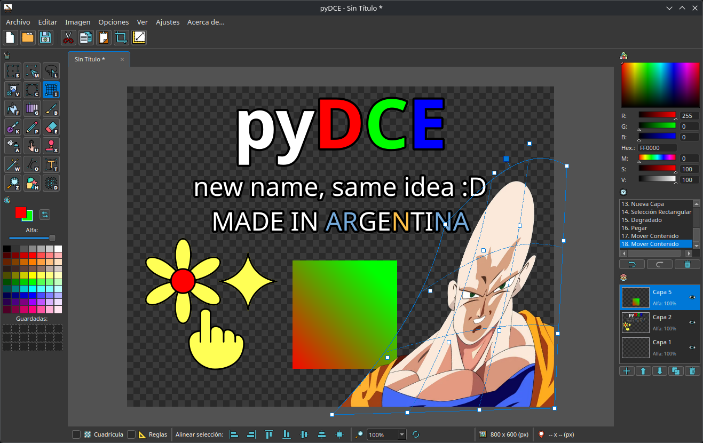

<p align="center">
  
</p>

<h1 align="center"><b>pyDCE</b> : <b>Py</b>thon <b>D</b>igital <b>C</b>anvas <b>E</b>ditor</h1>

<p align="center">
  <b>Un éditeur d'images léger, puissant et moderne pour Linux inspiré de Paint.NET.</b>
</p>

<p align="center">
  <a href="https://github.com/adrianandin0/pyDCE/stargazers"></a>
  <a href="https://github.com/adrianandin0/pyDCE/issues"></a>
  <a href="https://github.com/adrianandin0/pyDCE/blob/main/LICENSE"></a>
  <a href="https://x.com/adrian_and_ino"></a>
</p>

<p align="center">
  <a href="README.md">English</a> | <a href="README.es.md">Español</a> | <a href="README.pt.md">Português</a> | <b>Français</b> | <a href="README.zh-CN.md">简体中文 (zh-CN)</a>
</p>

<p align="center">
  
</p>

---

## Table des Matières
- [À propos du Projet](#à-propos-du-projet)
- [Fonctionnalités Clés](#fonctionnalités-clés)
- [Outils](#outils)
- [Détails Techniques](#détails-techniques)
- [Guide d'Installation](#guide-dinstallation)
  - [Installation sous Linux (Plateforme Principale)](#installation-sous-linux-plateforme-principale)
  - [Installation Optionnelle sous Windows](#installation-optionnelle-sous-windows)
  - [Installation et Compilation sous macOS](#installation-et-compilation-sous-macos)
  - [Exécution Directe depuis le Code Source](#exécution-directe-depuis-le-code-source)
- [Dépannage](#dépannage)
- [Contribuer](#contribuer)
- [Auteur et Contact](#auteur-et-contact)
- [Crédits](#crédits)

---

## À propos du Projet

**pyDCE** : **Py**thon **D**igital **C**anvas **E**ditor est un éditeur d'images développé avec **Python 3** et **PyQt6** en hommage à **Paint.NET**. Il a été créé pour combler l'absence de version officielle sous Linux, en offrant une expérience rapide, fluide et familière aux utilisateurs **Linux**. Bien que Python permette également de l'exécuter sous Windows et macOS, sa conception et son développement visent avant tout la communauté Linux.

---

## Fonctionnalités Clés

- **Interface Moderne** : Thèmes clair et sombre (incluant un damier de transparence adapté au thème).
- **Support Multilingue (i18n)** : Espagnol, Anglais, Portugais, Français et Chinois Simplifié (`zh-CN`), avec changement en direct depuis *Options → Préférences utilisateur* (sans redémarrage).
- **Calques** : Miniatures, visibilité, opacité, réorganisation, duplication et fusion.
- **Historique Complet (Annuler / Rétablir)** : Instantanés immuables du document optimisés par Copy-on-Write avec limite mémoire configurable.
- **Format Natif `.pnn`** : Format de projet prenant en charge les calques et la transparence ; association MIME automatique pour l'ouverture par double-clic.
- **Raccourcis Clavier Personnalisables** : Modifiez les raccourcis de tous les outils depuis *Options → Raccourcis clavier…*.
- **Impression et Exportation PDF** : Impression directe du canevas et génération de documents PDF.
- **Recherche et Insertion d'Images en Ligne** : Recherchez et insérez directement des images depuis Pexels, Unsplash, Pixabay, Wikimedia Commons, etc.
- **Formats d'Exportation** : PNG, JPG, BMP, WEBP, GIF, TIFF, ICO, TGA, PDF et `.pnn` natif.
- **Réglages d'Image et de Couleur** : Exposition, température et teinte, niveaux (points blanc/noir en entrée et sortie), sépia, postérisation, luminosité, contraste, teinte/saturation, inversion et noir et blanc.
- **Panneau de Couleur Avancé** : Sélecteur 2D de spectre, curseurs RGB/HSV et palette de couleurs enregistrées.

<p align="center">
  
</p>

---

## Outils

### Sélection
| Outil | Description |
|---|---|
| Sélection rectangulaire | Sélectionne des zones rectangulaires |
| Sélection elliptique | Sélectionne des zones elliptiques |
| Lasso libre | Sélection de contour à main levée |
| Baguette magique | Sélection de zones selon la tolérance de couleur |
| Déplacer le contenu | Déplace les pixels sélectionnés |
| Déplacer la sélection | Déplace uniquement le cadre de sélection |
| Transformer | Redimensionne, pivote et ajuste avec des poignées de contrôle |

### Dessin et Peinture
| Outil | Description |
|---|---|
| Crayon | Dessin précis au pixel ; mode réaliste avec réglages de dureté et de poussière |
| Pinceau | Épaisseur personnalisable, lissage et forme de pointe |
| Gomme | Effacement avec taille et forme configurables |
| Aérosol | Peinture en spray avec densité et effet de coulure |
| Doigt (Estomper) | Étire et mélange les pixels sur le canevas |
| Tampon de clonage | Échantillonne une zone de référence et duplique les pixels ailleurs |
| Pot de peinture | Remplit des zones selon la tolérance de couleur |
| Dégradé | Remplissage par dégradés linéaires ou radiaux |
| Ligne / Courbes | Trace des lignes et courbes avec points de contrôle Bézier |
| Formes | Formes géométriques (Rectangles, Ellipses, Étoiles, Polygones, Soleil, Étincelle, Losange, etc.) |
| Texte | Ajoute du texte avec choix de police, contour, lueur et ombre |
| Pipette | Prélève une couleur directement sur le canevas |
| Zoom | Zoome/dézoome ou sélectionne une zone précise |

<p align="center">
  
</p>

---

## Détails Techniques

### Architecture (v2)

pyDCE est structuré en composants modulaires :

| Module | Rôle |
|--------|------|
| `core/canvas.py` | Widget principal du canevas (`CanvasWidget`) : état du document, historique et opérations fichier/image |
| `core/canvas_input_handler.py` | Mappage et répartition des événements souris (flux unique d'entrée) |
| `core/canvas_renderer.py` | Composition des calques, damier de transparence et rendu de la grille de pixels |
| `core/opengl_canvas.py` | Widget optionnel accéléré par OpenGL (`QOpenGLWidget`) |
| `core/layers.py` | Gestionnaire de calques, cache de composition et Copy-on-Write |
| `core/history.py` | Pile d'historique Annuler / Rétablir et gestion de la RAM |
| `core/selection.py` | Moteur de sélection et contenu flottant |
| `core/stroke_smoother.py` | Lissage des traits (interpolation Bézier / filtrage) |
| `core/theme.py` | Gestionnaire de thèmes Clair/Sombre et palette du damier de transparence |
| `core/pnn_format.py` | Lecture et écriture du format natif `.pnn` |
| `core/pexels.py` + `gui/dialogo_pexels.py` | Moteur de recherche d'images en ligne et boîte de dialogue de sélection |
| `tools/` | Classes d'outils individuelles respectant une interface commune (`mouse_press`, `move`, `release`) |
| `gui/` | Panneaux d'interface, boîtes de dialogue, barre d'état et mise en page |

### Comportements Clés du Système

- **Pipeline d'Entrée Unifié** : Tous les événements souris du canevas sont traités par `CanvasInputHandler`, qui gère le mappage des coordonnées (zoom/décalage), applique Copy-on-Write uniquement pour les outils d'édition et enregistre les états d'historique.
- **Historique Copy-on-Write** : Les instantanés partagent les calques non modifiés via le Copy-on-Write natif de Qt, évitant les copies inutiles et réduisant l'utilisation de la RAM.
- **Cohérence des Thèmes** : L'arrière-plan de transparence du canevas, des miniatures de calques et des aperçus de recherche en ligne utilise une définition unique (`ThemeManager.colores_checkerboard()`).
- **Gestion des Calques** : Fusion par opacité, calques temporaires de tracé et sélections flottantes ; rafraîchissement dynamique des miniatures lors d'un changement de thème.
- **Dépendances Principales** : PyQt6, NumPy, OpenCV, Pillow, Requests (recherche en ligne). Empaquetage optionnel via PyInstaller.

### Plateformes

- **Linux** (Debian/Ubuntu, Fedora, Arch Linux, openSUSE et dérivées)
- **Windows** (support optionnel via installateurs `.bat` et Inno Setup)
- **macOS** (11.0 Big Sur et versions ultérieures sur Apple Silicon et Intel)

<p align="center">
  
</p>

---

## Guide d'Installation

Avant d'exécuter les installateurs ou de compiler depuis les sources, assurez-vous que **Python 3** et **Git** sont installés sur votre système.

---

### Installation sous Linux (Plateforme Principale)

#### Étape 1 : Installer Python, Git et les Dépendances Système
Ouvrez votre terminal et exécutez la commande correspondant à votre distribution :

- **Debian / Ubuntu / Linux Mint / Pop!_OS** :
  ```bash
  sudo apt update
  sudo apt install -y python3 python3-pip python3-venv git build-essential libxcb-cursor0 libegl1 libgl1 libdbus-1-3
  ```

- **Fedora / RedHat / RHEL / CentOS / AlmaLinux** :
  ```bash
  sudo dnf install -y python3 python3-pip git gcc gcc-c++ libxcb mesa-libEGL mesa-libGL dbus-libs
  ```

- **Arch Linux / Manjaro / EndeavourOS** :
  ```bash
  sudo pacman -Sy --needed --noconfirm python python-pip git base-devel libxcb xcb-util xcb-util-cursor xcb-util-image xcb-util-keysyms xcb-util-renderutil xcb-util-wm libegl libgl dbus
  ```

- **openSUSE / SUSE Linux Enterprise** :
  ```bash
  sudo zypper install -y python3 python3-pip git gcc libxcb-cursor0 libEGL1 libGL1 libdbus-1-3
  ```

#### Étape 2 : Cloner le Dépôt
```bash
git clone https://github.com/adrianandin0/pyDCE.git
cd pyDCE
```

#### Étape 3 : Lancer l'Installateur Automatique (`install.sh`)
Le script `install.sh` configure un environnement virtuel, installe les dépendances, compile le binaire via PyInstaller et crée les raccourcis bureau :
```bash
sudo ./install.sh
```
Choisissez votre langue préférée (`01 - Español` / `02 - English` / `03 - Português` / `04 - Français` / `05 - 简体中文 (zh-CN)`). Une fois terminé, lancez pyDCE depuis le menu des applications ou en exécutant :
```bash
pydce
```

---

### Installation Optionnelle sous Windows

> [!NOTE]
> **Note pour les utilisateurs Windows** :  
> Si vous utilisez Windows, nous vous recommandons vivement l'application officielle **[Paint.NET](https://www.getpaint.net/)**. pyDCE a été conçu comme un hommage dédié à la communauté Linux. Bien que Python permette de l'exécuter sous Windows, nous encourageons le soutien au logiciel d'origine sur sa plateforme native.

#### Étape 1 : Installer Python et Git via Winget
Ouvrez **l'Invite de commandes (CMD)** ou **PowerShell** et exécutez :
```cmd
winget install --id Python.Python.3.12 -e & winget install --id Git.Git -e
```
*IMPORTANT* : Fermez la fenêtre de terminal actuelle et ouvrez-en une nouvelle après l'installation pour actualiser les variables d'environnement.

*(Alternative sans Winget)* : Téléchargez Python manuellement depuis [python.org/downloads](https://www.python.org/downloads/) (cochez **"Add python.exe to PATH"**) et Git depuis [git-scm.com](https://git-scm.com/).

#### Étape 2 : Cloner le Dépôt
Dans votre **nouvelle fenêtre de terminal**, exécutez :
```cmd
git clone https://github.com/adrianandin0/pyDCE.git
cd pyDCE
```

#### Étape 3 : Configurer l'Environnement Virtuel et les Dépendances
```cmd
python -m venv venv
call venv\Scripts\activate.bat
pip install --upgrade pip
pip install -r requirements_windows.txt pyinstaller
```

#### Étape 4 : Exécuter l'Installateur Windows (`install.bat`)
```cmd
install.bat
```
Compile l'exécutable natif, l'installe dans `%LOCALAPPDATA%\pyDCE` et crée des raccourcis sur le **Bureau** et dans le **Menu Démarrer**.

---

### Installation et Compilation sous macOS

pyDCE prend en charge macOS 11.0 (Big Sur) et versions ultérieures sur Apple Silicon et Intel.

#### Application Précompilée (.app / .zip / .dmg)
1. Téléchargez le dernier fichier `pyDCE-*-macos.zip` ou `pyDCE-*-macos.dmg` depuis la section Releases.
2. Ouvrez le DMG ou extrayez le ZIP.
3. Glissez `pyDCE.app` dans `/Applications`.
4. Si macOS Gatekeeper indique que le développeur ne peut pas être vérifié :
   - Faites un clic droit sur `pyDCE.app` et sélectionnez **Ouvrir**, ou
   - Exécutez dans le Terminal :
     ```bash
     xattr -cr /Applications/pyDCE.app
     ```

#### Compiler depuis les Sources sous macOS
```bash
git clone https://github.com/adrianandin0/pyDCE.git
cd pyDCE
chmod +x build_macos.sh
./build_macos.sh
```
Le script compile `dist_pkg/pyDCE.app`, applique une signature ad-hoc et génère `pyDCE-*-macos.zip` et `pyDCE-*-macos.dmg`.

---

### Exécution Directe depuis le Code Source

Si vous préférez ne pas compiler ni installer de paquets système, exécutez pyDCE directement avec Python (après avoir complété l'Étape 1 de votre OS) :

#### Linux :
```bash
git clone https://github.com/adrianandin0/pyDCE.git
cd pyDCE
python3 -m venv venv
source venv/bin/activate
pip install --upgrade pip
pip install -r requirements_linux.txt
python main.py
```

#### Windows :
```cmd
git clone https://github.com/adrianandin0/pyDCE.git
cd pyDCE
python -m venv venv
call venv\Scripts\activate.bat
pip install --upgrade pip
pip install -r requirements_windows.txt
python main.py
```

#### macOS :
```bash
git clone https://github.com/adrianandin0/pyDCE.git
cd pyDCE
python3 -m venv venv
source venv/bin/activate
pip install --upgrade pip
pip install -r requirements_macos.txt
python main.py
```

---

## Dépannage

### 1. `python3: command not found` ou `python n'est pas reconnu`
- **Cause** : Python n'est pas installé ou n'a pas été ajouté au `PATH`.
- **Solution Linux** : Complétez l'Étape 1 avec `sudo apt install python3 python3-pip python3-venv` (ou équivalent de votre distribution).
- **Solution Windows** : Exécutez `winget install --id Python.Python.3.12 -e` et **redémarrez le terminal**.

### 2. `git n'est pas reconnu`
- **Cause** : Git est manquant ou le terminal n'a pas été redémarré après son installation.
- **Solution** : Installez Git (`winget install --id Git.Git -e` sous Windows ou `sudo apt install git` sous Linux) et **redémarrez le terminal**.

### 3. `pip: command not found`
- **Solution Linux** : Installez pip via `sudo apt install python3-pip` (Debian/Ubuntu) ou `sudo dnf install python3-pip` (Fedora).
- **Solution Windows** : Exécutez `python -m ensurepip --upgrade`.

### 4. Erreur `externally-managed-environment` sur Linux Moderne (Debian 12+, Ubuntu 23.04+, Arch)
- **Cause** : Les distributions modernes bloquent l'installation globale de paquets `pip` hors environnement virtuel.
- **Solution** : Utilisez toujours un environnement virtuel (`python3 -m venv venv` et `source venv/bin/activate`) ou exécutez `sudo ./install.sh`, qui gère l'isolation automatiquement.

### 5. `pyinstaller: command not found`
- **Cause** : PyInstaller n'est pas installé dans l'environnement virtuel actif.
- **Solution** : Activez votre environnement virtuel et exécutez `pip install pyinstaller`.

### 6. `winget n'est pas reconnu` sous Windows
- **Cause** : Anciennes versions de Windows 10 sans App Installer.
- **Solution** : Téléchargez manuellement Python depuis [python.org](https://www.python.org/downloads/) (en cochant **"Add python.exe to PATH"**) et Git depuis [git-scm.com](https://git-scm.com/).

---

## Contribuer

Les contributions, traductions et signalements de bugs sont les bienvenus !

- **Signaler un bug** : Ouvrez une issue sur [GitHub Issues](https://github.com/adrianandin0/pyDCE/issues).
- **Proposer du code** : Forkez le dépôt, créez une branche et ouvrez une Pull Request.

---

## Auteur et Contact

- **Développeur** : Adrian
- **X (Twitter)** : [@adrian_and_ino](https://x.com/adrian_and_ino)
- **GitHub** : [adrianandin0/pyDCE](https://github.com/adrianandin0/pyDCE)

Développé en Python avec l'aide de **Google Gemini** et **Google Antigravity**.

---

## Crédits

Remerciements particuliers aux créateurs d'icônes de Flaticon :

| Auteur | Lien |
|---|---|
| Flaticon | [flaticon.com](https://www.flaticon.com/) |
| Smashicons | [authors/smashicons](https://www.flaticon.com/authors/smashicons) |
| Magnific | [authors/magnific](https://www.flaticon.com/authors/magnific) |
| Pixel perfect | [authors/pixel-perfect](https://www.flaticon.com/authors/pixel-perfect) |

---

<p align="center">Si vous aimez le projet, n'hésitez pas à laisser une étoile sur GitHub.</p>
