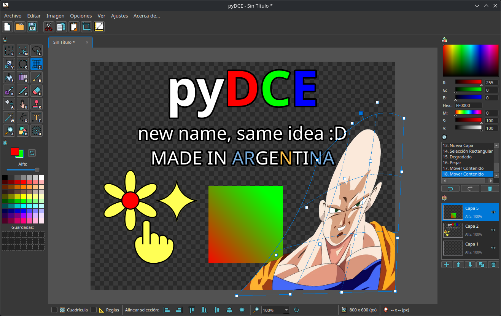

<p align="center">
  
</p>

<h1 align="center"><b>pyDCE</b>: <b>Py</b>thon <b>D</b>igital <b>C</b>anvas <b>E</b>ditor</h1>

<p align="center">
  <b>Um editor de imagens leve, potente e moderno para Linux inspirado no Paint.NET.</b>
</p>

<p align="center">
  <a href="https://github.com/adrianandin0/pyDCE/stargazers"></a>
  <a href="https://github.com/adrianandin0/pyDCE/issues"></a>
  <a href="https://github.com/adrianandin0/pyDCE/blob/main/LICENSE"></a>
  <a href="https://x.com/adrian_and_ino"></a>
</p>

<p align="center">
  <a href="README.md">English</a> | <a href="README.es.md">Español</a> | <b>Português</b> | <a href="README.fr.md">Français</a> | <a href="README.zh-CN.md">简体中文 (zh-CN)</a>
</p>

<p align="center">
  
</p>

---

## Sumário
- [Sobre o Projeto](#sobre-o-projeto)
- [Principais Recursos](#principais-recursos)
- [Ferramentas](#ferramentas)
- [Detalhes Técnicos](#detalhes-técnicos)
- [Guia de Instalação](#guia-de-instalação)
  - [Instalação no Linux (Plataforma Principal)](#instalação-no-linux-plataforma-principal)
  - [Instalação Opcional no Windows](#instalação-opcional-no-windows)
  - [Instalação e Compilação no macOS](#instalação-e-compilação-no-macos)
  - [Execução Direta a partir do Código-Fonte](#execução-direta-a-partir-do-código-fonte)
- [Solução de Problemas](#solução-de-problemas)
- [Contribuir](#contribuir)
- [Autor e Contato](#autor-e-contato)
- [Créditos](#créditos)

---

## Sobre o Projeto

**pyDCE**: **Py**thon **D**igital **C**anvas **E**ditor é um editor de imagens desenvolvido com **Python 3** e **PyQt6** em homenagem ao **Paint.NET**. Ele foi criado para preencher a ausência de uma versão oficial para Linux, oferecendo uma experiência rápida, fluida e familiar para usuários de **Linux**. Embora o Python permita executá-lo também no Windows e macOS, seu design e desenvolvimento são voltados principalmente para a comunidade Linux.

---

## Principais Recursos

- **Interface Moderna**: Temas claro e escuro (com padrão quadriculado de transparência adaptado ao tema).
- **Suporte Multilíngue (i18n)**: Espanhol, Inglês, Português, Francês e Chinês Simplificado (`zh-CN`), com troca instantânea em *Opções → Preferências do usuário* (sem reiniciar).
- **Camadas**: Miniaturas, visibilidade, opacidade, reordenação, duplicação e mesclagem.
- **Histórico Completo (Desfazer / Refazer)**: Instantâneos imutáveis do documento otimizados com Copy-on-Write e limite de memória configurável.
- **Formato Nativo `.pnn`**: Formato de projeto com camadas e transparência; associação MIME automática para abertura com clique duplo.
- **Atalhos de Teclado Personalizáveis**: Reconfigure atalhos de todas as ferramentas em *Opções → Atalhos de teclado…*.
- **Impressão e Exportação em PDF**: Suporte direto à impressão da tela e geração de documentos PDF.
- **Busca e Inserção de Imagens Online**: Pesquise e insira imagens diretamente do Pexels, Unsplash, Pixabay, Wikimedia Commons, entre outros.
- **Formatos de Exportação**: PNG, JPG, BMP, WEBP, GIF, TIFF, ICO, TGA, PDF e `.pnn` nativo.
- **Ajustes de Imagem e Cor**: Exposição, temperatura e matiz, níveis (pontos branco/preto de entrada e saída), sépia, posterização, brilho, contraste, matiz/saturação, inverter e preto e branco.
- **Painel de Cor Avançado**: Seletor 2D de espectro, controles deslizantes RGB/HSV e histórico de paleta salva.

<p align="center">
  
</p>

---

## Ferramentas

### Seleção
| Ferramenta | Descrição |
|---|---|
| Seleção retangular | Seleciona áreas retangulares |
| Seleção elíptica | Seleciona áreas elípticas |
| Laço livre | Seleção de contorno à mão livre |
| Varinha mágica | Seleção de áreas por tolerância de cor |
| Mover pixels | Move o conteúdo de pixels selecionado |
| Mover seleção | Move apenas a moldura da seleção |
| Transformar | Redimensiona, gira e ajusta com alças de controle |

### Desenho e Pintura
| Ferramenta | Descrição |
|---|---|
| Lápis | Desenho preciso de pixels; modo realista com controles de dureza e pó |
| Pincel | Largura personalizada, suavização e formato da ponta |
| Borracha | Apaga com tamanho e formato configuráveis |
| Spray | Pintura em spray com densidade e efeito de gotejamento |
| Borrar (Dedo) | Arrasta e mistura pixels na tela |
| Carimbo | Amostra uma área de referência e duplica pixels em outro local |
| Balde de tinta | Preenche áreas por tolerância de cor |
| Gradiente | Preenchimento com gradientes lineares ou radiais |
| Linha / Curvas | Desenha linhas e curvas com pontos de controle Bézier |
| Formas | Formas geométricas (Retângulos, Elipses, Estrelas, Polígonos, Sol, Brilho, Losango, etc.) |
| Texto | Adiciona texto com escolha de fonte, contorno, brilho e sombra |
| Conta-gotas | Captura cores diretamente da tela |
| Zoom | Aproxima/afasta ou seleciona uma área específica |

<p align="center">
  
</p>

---

## Detalhes Técnicos

### Arquitetura (v2)

O pyDCE é estruturado em componentes modulares:

| Módulo | Função |
|--------|--------|
| `core/canvas.py` | Widget principal da tela (`CanvasWidget`): estado do documento, histórico e operações de arquivo/imagem |
| `core/canvas_input_handler.py` | Mapeamento e despacho de eventos do mouse (caminho único de entrada) |
| `core/canvas_renderer.py` | Composição de camadas, padrão de transparência e renderização da grade de pixels |
| `core/opengl_canvas.py` | Widget opcional acelerado por OpenGL (`QOpenGLWidget`) |
| `core/layers.py` | Gerenciador de camadas, cache de composição e Copy-on-Write |
| `core/history.py` | Pilha de histórico Desfazer / Refazer e controle de RAM |
| `core/selection.py` | Motor de seleção e conteúdo flutuante |
| `core/stroke_smoother.py` | Suavização de traços (interpolação Bézier / filtragem) |
| `core/theme.py` | Gerenciador de temas Claro/Escuro e paleta do padrão de transparência |
| `core/pnn_format.py` | Leitura e gravação do formato nativo `.pnn` |
| `core/pexels.py` + `gui/dialogo_pexels.py` | Motor de busca de imagens online e diálogo de seleção |
| `tools/` | Classes individuais de ferramentas com interface comum (`mouse_press`, `move`, `release`) |
| `gui/` | Painéis de interface, diálogos, barra de status e construtores de layout |

### Comportamentos Principais do Sistema

- **Pipeline de Entrada Unificado**: Todos os eventos de mouse da tela passam pelo `CanvasInputHandler`, que trata o mapeamento de coordenadas (zoom/deslocamento), aplica Copy-on-Write apenas em ferramentas de edição e registra estados no histórico.
- **Histórico Copy-on-Write**: Os instantâneos compartilham camadas não modificadas usando Copy-on-Write nativo do Qt, evitando cópias desnecessárias e reduzindo o uso de RAM.
- **Consistência de Tema**: O fundo de transparência da tela principal, das miniaturas de camadas e dos cartões de busca online utiliza uma única definição (`ThemeManager.colores_checkerboard()`).
- **Gerenciamento de Camadas**: Mistura por opacidade, camadas temporárias de traço e seleções flutuantes; atualização dinâmica das miniaturas ao trocar o tema.
- **Dependências Principais**: PyQt6, NumPy, OpenCV, Pillow, Requests (busca online). Empacotamento opcional via PyInstaller.

### Plataformas

- **Linux** (Debian/Ubuntu, Fedora, Arch Linux, openSUSE e derivados)
- **Windows** (suporte opcional com instaladores `.bat` e Inno Setup)
- **macOS** (11.0 Big Sur ou superior em Apple Silicon e Intel)

<p align="center">
  
</p>

---

## Guia de Instalação

Antes de executar os instaladores ou compilar a partir do código-fonte, certifique-se de ter **Python 3** e **Git** instalados.

---

### Instalação no Linux (Plataforma Principal)

#### Passo 1: Instalar Python, Git e Dependências do Sistema
Abra o terminal e execute o comando correspondente à sua distribuição:

- **Debian / Ubuntu / Linux Mint / Pop!_OS**:
  ```bash
  sudo apt update
  sudo apt install -y python3 python3-pip python3-venv git build-essential libxcb-cursor0 libegl1 libgl1 libdbus-1-3
  ```

- **Fedora / RedHat / RHEL / CentOS / AlmaLinux**:
  ```bash
  sudo dnf install -y python3 python3-pip git gcc gcc-c++ libxcb mesa-libEGL mesa-libGL dbus-libs
  ```

- **Arch Linux / Manjaro / EndeavourOS**:
  ```bash
  sudo pacman -Sy --needed --noconfirm python python-pip git base-devel libxcb xcb-util xcb-util-cursor xcb-util-image xcb-util-keysyms xcb-util-renderutil xcb-util-wm libegl libgl dbus
  ```

- **openSUSE / SUSE Linux Enterprise**:
  ```bash
  sudo zypper install -y python3 python3-pip git gcc libxcb-cursor0 libEGL1 libGL1 libdbus-1-3
  ```

#### Passo 2: Clonar o Repositório
```bash
git clone https://github.com/adrianandin0/pyDCE.git
cd pyDCE
```

#### Passo 3: Executar o Instalador Automático (`install.sh`)
O script `install.sh` cria o ambiente virtual, instala as dependências, compila o binário com PyInstaller e cria atalhos na área de trabalho:
```bash
sudo ./install.sh
```
Escolha seu idioma preferido (`01 - Español` / `02 - English` / `03 - Português` / `04 - Français` / `05 - 简体中文 (zh-CN)`). Ao concluir, inicie o pyDCE pelo menu de aplicativos ou executando:
```bash
pydce
```

---

### Instalação Opcional no Windows

> [!NOTE]
> **Nota para usuários do Windows**:  
> Se você usa Windows, recomendamos fortemente o aplicativo oficial **[Paint.NET](https://www.getpaint.net/)**. O pyDCE foi criado como uma homenagem dedicada à comunidade Linux. Embora o Python permita executá-lo no Windows, incentivamos o apoio ao software original em sua plataforma nativa.

#### Passo 1: Instalar Python e Git via Winget
Abra o **Prompt de Comando (CMD)** ou **PowerShell** e execute:
```cmd
winget install --id Python.Python.3.12 -e & winget install --id Git.Git -e
```
*IMPORTANTE*: Feche a janela do terminal atual e abra uma nova após a instalação para atualizar as variáveis de ambiente.

*(Alternativa sem Winget)*: Baixe o Python manualmente em [python.org/downloads](https://www.python.org/downloads/) (marque **"Add python.exe to PATH"**) e o Git em [git-scm.com](https://git-scm.com/).

#### Passo 2: Clonar o Repositório
Na **nova janela do terminal**, execute:
```cmd
git clone https://github.com/adrianandin0/pyDCE.git
cd pyDCE
```

#### Passo 3: Configurar Ambiente Virtual e Dependências
```cmd
python -m venv venv
call venv\Scripts\activate.bat
pip install --upgrade pip
pip install -r requirements_windows.txt pyinstaller
```

#### Passo 4: Executar o Instalador do Windows (`install.bat`)
```cmd
install.bat
```
Compila o executável nativo, instala em `%LOCALAPPDATA%\pyDCE` e cria atalhos na **Área de Trabalho** e no **Menu Iniciar**.

---

### Instalação e Compilação no macOS

O pyDCE oferece suporte ao macOS 11.0 (Big Sur) e posteriores em Macs com Apple Silicon e Intel.

#### Aplicativo Pré-compilado (.app / .zip / .dmg)
1. Baixe o arquivo `pyDCE-*-macos.zip` ou `pyDCE-*-macos.dmg` mais recente em Releases.
2. Abra o DMG ou extraia o ZIP.
3. Arraste `pyDCE.app` para `/Applications`.
4. Se o Gatekeeper do macOS avisar que não é possível verificar o desenvolvedor:
   - Clique com o botão direito em `pyDCE.app` e selecione **Abrir**, ou
   - Execute no Terminal:
     ```bash
     xattr -cr /Applications/pyDCE.app
     ```

#### Compilar a partir do Código-Fonte no macOS
```bash
git clone https://github.com/adrianandin0/pyDCE.git
cd pyDCE
chmod +x build_macos.sh
./build_macos.sh
```
O script compila `dist_pkg/pyDCE.app`, realiza assinatura ad-hoc e gera `pyDCE-*-macos.zip` e `pyDCE-*-macos.dmg`.

---

### Execução Direta a partir do Código-Fonte

Se preferir não compilar nem instalar pacotes do sistema, execute o pyDCE diretamente com Python (após concluir o Passo 1 do seu sistema):

#### Linux:
```bash
git clone https://github.com/adrianandin0/pyDCE.git
cd pyDCE
python3 -m venv venv
source venv/bin/activate
pip install --upgrade pip
pip install -r requirements_linux.txt
python main.py
```

#### Windows:
```cmd
git clone https://github.com/adrianandin0/pyDCE.git
cd pyDCE
python -m venv venv
call venv\Scripts\activate.bat
pip install --upgrade pip
pip install -r requirements_windows.txt
python main.py
```

#### macOS:
```bash
git clone https://github.com/adrianandin0/pyDCE.git
cd pyDCE
python3 -m venv venv
source venv/bin/activate
pip install --upgrade pip
pip install -r requirements_macos.txt
python main.py
```

---

## Solução de Problemas

### 1. `python3: command not found` ou `python não é reconhecido`
- **Causa**: O Python não está instalado ou não foi adicionado à variável `PATH`.
- **Solução no Linux**: Complete o Passo 1 com `sudo apt install python3 python3-pip python3-venv` (ou equivalente da sua distribuição).
- **Solução no Windows**: Execute `winget install --id Python.Python.3.12 -e` e **reinicie o terminal**.

### 2. `git não é reconhecido`
- **Causa**: O Git está ausente ou o terminal não foi reiniciado após a instalação.
- **Solução**: Instale o Git (`winget install --id Git.Git -e` no Windows ou `sudo apt install git` no Linux) e **reinicie o terminal**.

### 3. `pip: command not found`
- **Solução no Linux**: Instale o pip com `sudo apt install python3-pip` (Debian/Ubuntu) ou `sudo dnf install python3-pip` (Fedora).
- **Solução no Windows**: Execute `python -m ensurepip --upgrade`.

### 4. Erro `externally-managed-environment` em Linux Moderno (Debian 12+, Ubuntu 23.04+, Arch)
- **Causa**: Distribuições modernas bloqueiam a instalação global de pacotes via `pip` fora de ambientes virtuais.
- **Solução**: Use sempre um ambiente virtual (`python3 -m venv venv` e `source venv/bin/activate`) ou execute `sudo ./install.sh`, que gerencia o isolamento automaticamente.

### 5. `pyinstaller: command not found`
- **Causa**: O PyInstaller não está instalado no ambiente virtual ativo.
- **Solução**: Ative o ambiente virtual e execute `pip install pyinstaller`.

### 6. `winget não é reconhecido` no Windows
- **Causa**: Versões antigas do Windows 10 sem o App Installer.
- **Solução**: Baixe manualmente o Python em [python.org](https://www.python.org/downloads/) (marcando **"Add python.exe to PATH"**) e o Git em [git-scm.com](https://git-scm.com/).

---

## Contribuir

Contribuições, traduções e relatos de bugs são bem-vindos!

- **Relatar um bug**: Abra uma issue em [GitHub Issues](https://github.com/adrianandin0/pyDCE/issues).
- **Enviar código**: Faça um fork do repositório, crie uma branch e abra um Pull Request.

---

## Autor e Contato

- **Desenvolvedor**: Adrian
- **X (Twitter)**: [@adrian_and_ino](https://x.com/adrian_and_ino)
- **GitHub**: [adrianandin0/pyDCE](https://github.com/adrianandin0/pyDCE)

Desenvolvido em Python com assistência do **Google Gemini** e **Google Antigravity**.

---

## Créditos

Agradecimento especial aos criadores de ícones do Flaticon:

| Autor | Link |
|---|---|
| Flaticon | [flaticon.com](https://www.flaticon.com/) |
| Smashicons | [authors/smashicons](https://www.flaticon.com/authors/smashicons) |
| Magnific | [authors/magnific](https://www.flaticon.com/authors/magnific) |
| Pixel perfect | [authors/pixel-perfect](https://www.flaticon.com/authors/pixel-perfect) |

---

<p align="center">Se você gostou do projeto, dê uma estrela no GitHub.</p>
