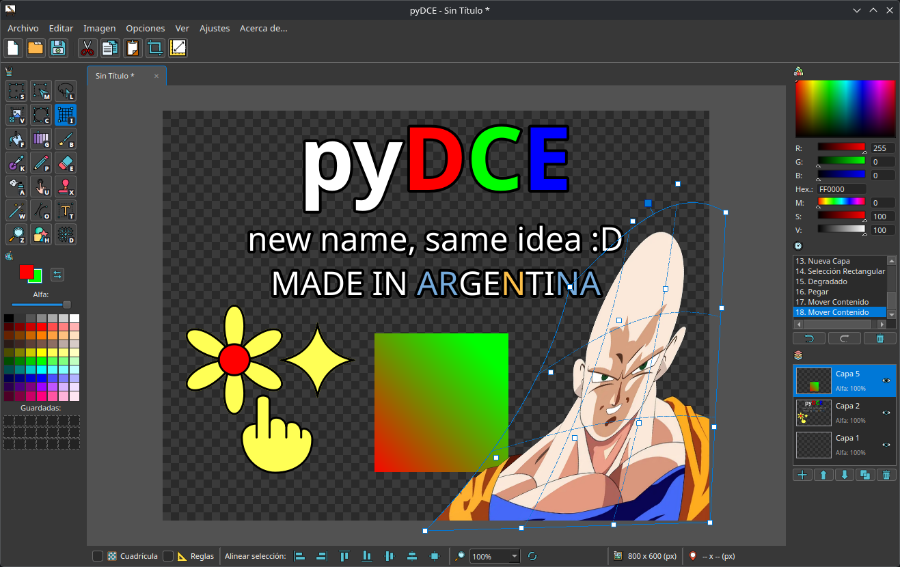

<p align="center">
  
</p>

<h1 align="center"><b>pyDCE</b>：<b>Py</b>thon <b>D</b>igital <b>C</b>anvas <b>E</b>ditor</h1>

<p align="center">
  <b>受 Paint.NET 启发、面向 Linux 的轻量、强大且现代的图像编辑器。</b>
</p>

<p align="center">
  <a href="https://github.com/adrianandin0/pyDCE/stargazers"></a>
  <a href="https://github.com/adrianandin0/pyDCE/issues"></a>
  <a href="https://github.com/adrianandin0/pyDCE/blob/main/LICENSE"></a>
  <a href="https://x.com/adrian_and_ino"></a>
</p>

<p align="center">
  <a href="README.md">English</a> | <a href="README.es.md">Español</a> | <a href="README.pt.md">Português</a> | <a href="README.fr.md">Français</a> | <b>简体中文 (zh-CN)</b>
</p>

<p align="center">
  
</p>

> [!NOTE]
> 如果您有兴趣协助改进 pyDCE 的简体中文翻译，请联系 [adrianandino@pm.me](mailto:adrianandino@pm.me) 并附上您的意见或建议。

---

## 目录
- [项目简介](#项目简介)
- [核心功能](#核心功能)
- [工具列表](#工具列表)
- [技术细节](#技术细节)
- [安装指南](#安装指南)
  - [Linux 安装（主要平台）](#linux-安装主要平台)
  - [Windows 可选安装](#windows-可选安装)
  - [macOS 安装与编译](#macos-安装与编译)
  - [从源码直接运行](#从源码直接运行)
- [常见问题排查](#常见问题排查)
- [参与贡献](#参与贡献)
- [作者与联系方式](#作者与联系方式)
- [鸣谢](#鸣谢)

---

## 项目简介

**pyDCE**（**Py**thon **D**igital **C**anvas **E**ditor）是一款基于 **Python 3** 和 **PyQt6** 开发的图像编辑器，旨在向 **Paint.NET** 致敬。它的诞生是为了填补 Paint.NET 缺乏官方 Linux 版本的空白，为 **Linux** 用户提供快速、流畅且熟悉的图像编辑体验。虽然 Python 的跨平台特性使其也能在 Windows 和 macOS 上运行，但其设计与开发仍主要面向 Linux 社区。

---

## 核心功能

- **现代界面**：支持浅色和深色主题（包含随主题自适应的透明棋盘格背景）。
- **多语言支持 (i18n)**：支持西班牙语、英语、法语、葡萄牙语和简体中文（`zh-CN`），可在 *选项 → 用户偏好设置* 中即时切换（无需重启）。
- **图层系统**：支持缩略图预览、可见性切换、不透明度调节、顺序调整、复制与合并。
- **完整历史记录（撤销 / 重做）**：基于写时复制（Copy-on-Write）的文档快照，支持内存上限配置。
- **原生 `.pnn` 格式**：支持多图层与透明通道的项目格式，并自动注册 MIME 关联以便双击打开。
- **自定义键盘快捷键**：可在 *选项 → 键盘快捷键...* 中自由修改所有工具的快捷键。
- **打印与 PDF 导出**：支持直接打印画布以及导出为 PDF 文档。
- **在线图像搜索与插入**：可直接搜索并插入来自 Pexels、Unsplash、Pixabay、Wikimedia Commons 等来源的图片。
- **丰富的导出格式**：支持 PNG、JPG、BMP、WEBP、GIF、TIFF、ICO、TGA、PDF 以及原生 `.pnn`。
- **图像与色彩调整**：支持曝光度、色温与色调、色阶（输入/输出黑场与白场）、复古棕褐色、色调分离、亮度/对比度、色相/饱和度、反相以及黑白去色。
- **高级颜色面板**：色轮、RGB/HSV/CMYK 滑块以及已保存调色板历史。

<p align="center">
  
</p>

---

## 工具列表

### 选区工具
| 工具 | 说明 |
|---|---|
| 矩形选区 | 选择矩形区域 |
| 椭圆选区 | 选择椭圆区域 |
| 自由套索 | 手绘自由轮廓选区 |
| 魔棒 | 按颜色容差选择区域 |
| 移动像素 | 移动选中区域的像素内容 |
| 移动选区 | 仅移动选区边框 |
| 变换 | 使用控制手柄进行缩放、旋转和调整 |

### 绘图与填充工具
| 工具 | 说明 |
|---|---|
| 铅笔 | 精准像素绘制；支持带硬度与粉尘控制的写实模式 |
| 画笔 | 可自定义粗细、平滑度与笔尖形状 |
| 橡皮擦 | 可配置大小与形状的擦除工具 |
| 喷枪 | 支持密度与滴落效果的喷涂工具 |
| 涂抹 | 在画布上拖动并混合像素 |
| 仿制图章 | 采样参考区域并在其他位置复制像素 |
| 油漆桶 | 按颜色容差填充区域 |
| 渐变 | 支持线性或径向渐变填充 |
| 直线 / 曲线 | 绘制带贝塞尔控制手柄的直线与曲线 |
| 形状 | 几何图形（矩形、椭圆、星形、多边形、太阳、星芒、菱形等） |
| 文本 | 添加文本，支持字体选择、描边、外发光与阴影效果 |
| 取色器 | 直接从画布吸取颜色 |
| 缩放 | 放大/缩小或框选特定区域聚焦 |

<p align="center">
  
</p>

---

## 技术细节

### 架构 (v2)

pyDCE 采用模块化组件架构：

| 模块 | 职责 |
|--------|------|
| `core/canvas.py` | 主画布组件 (`CanvasWidget`)：文档状态、历史记录、文件与图像操作 |
| `core/canvas_input_handler.py` | 鼠标输入映射与分发（统一事件处理路径） |
| `core/canvas_renderer.py` | 图层合成、透明棋盘格与像素网格渲染 |
| `core/opengl_canvas.py` | 可选的 OpenGL 硬件加速画布组件 (`QOpenGLWidget`) |
| `core/layers.py` | 图层管理器、合成缓存与写时复制（CoW）处理 |
| `core/history.py` | 撤销 / 重做历史栈与内存限制管理 |
| `core/selection.py` | 选区引擎与浮动图像内容 |
| `core/stroke_smoother.py` | 笔触平滑（贝塞尔插值 / 滤波） |
| `core/theme.py` | 浅色/深色主题管理器与透明背景调色板 |
| `core/pnn_format.py` | 原生 `.pnn` 项目格式读写模块 |
| `core/pexels.py` + `gui/dialogo_pexels.py` | 在线图像搜索引擎与选择对话框 |
| `tools/` | 遵循统一事件接口（`mouse_press`、`move`、`release`）的独立工具类 |
| `gui/` | 界面面板、对话框、状态栏与布局构建器 |

### 核心系统特性

- **统一输入管线**：所有画布鼠标事件由 `CanvasInputHandler` 统一处理，负责坐标映射（缩放/偏移）、仅在编辑工具下执行写时复制并在适当时机记录历史状态。
- **高效写时复制历史**：文档快照利用 Qt 原生 Copy-on-Write 共享未修改图层的 `QImage` 缓冲区，大幅降低内存占用。
- **主题一致性**：主画布、图层缩略图和在线搜索预览卡片的透明棋盘格统一使用 `ThemeManager.colores_checkerboard()` 调色板定义。
- **图层管理**：支持不透明度混合、临时笔触图层与浮动选区叠加；切换主题时缩略图自动刷新。
- **主要依赖**：PyQt6、NumPy、OpenCV、Pillow、Requests（在线搜索）。可选使用 PyInstaller 打包为可执行程序。

### 支持平台

- **Linux**（Debian/Ubuntu、Fedora、Arch Linux、openSUSE 及衍生发行版）
- **Windows**（可选支持，提供 `.bat` 与 Inno Setup 安装程序）
- **macOS**（11.0 Big Sur 及以上，支持 Apple Silicon 与 Intel）

<p align="center">
  
</p>

---

## 安装指南

在运行安装程序或从源码编译前，请确保系统已安装 **Python 3** 和 **Git**。

---

### Linux 安装（主要平台）

#### 第 1 步：安装 Python、Git 及系统依赖
打开终端，根据你的发行版运行对应命令：

- **Debian / Ubuntu / Linux Mint / Pop!_OS**：
  ```bash
  sudo apt update
  sudo apt install -y python3 python3-pip python3-venv git build-essential libxcb-cursor0 libegl1 libgl1 libdbus-1-3
  ```

- **Fedora / RedHat / RHEL / CentOS / AlmaLinux**：
  ```bash
  sudo dnf install -y python3 python3-pip git gcc gcc-c++ libxcb mesa-libEGL mesa-libGL dbus-libs
  ```

- **Arch Linux / Manjaro / EndeavourOS**：
  ```bash
  sudo pacman -Sy --needed --noconfirm python python-pip git base-devel libxcb xcb-util xcb-util-cursor xcb-util-image xcb-util-keysyms xcb-util-renderutil xcb-util-wm libegl libgl dbus
  ```

- **openSUSE / SUSE Linux Enterprise**：
  ```bash
  sudo zypper install -y python3 python3-pip git gcc libxcb-cursor0 libEGL1 libGL1 libdbus-1-3
  ```

#### 第 2 步：克隆仓库
```bash
git clone https://github.com/adrianandin0/pyDCE.git
cd pyDCE
```

#### 第 3 步：运行自动安装脚本 (`install.sh`)
`install.sh` 会自动创建虚拟环境、安装依赖、通过 PyInstaller 编译可执行文件并创建桌面快捷方式：
```bash
sudo ./install.sh
```
按提示选择语言（`01 - Español` / `02 - English` / `03 - Português` / `04 - Français` / `05 - 简体中文 (zh-CN)`）。安装完成后，可从系统应用菜单启动或在终端中运行：
```bash
pydce
```

---

### Windows 可选安装

> [!NOTE]
> **给 Windows 用户的说明**：  
> 如果你正在使用 Windows，我们强烈推荐使用官方的 **[Paint.NET](https://www.getpaint.net/)**。pyDCE 是作为献给 Linux 社区的致敬项目而创建的。尽管 Python 允许它在 Windows 上运行，但我们鼓励在原生平台上支持原版软件。

#### 第 1 步：通过 Winget 安装 Python 和 Git
打开 **命令提示符 (CMD)** 或 **PowerShell** 并运行：
```cmd
winget install --id Python.Python.3.12 -e & winget install --id Git.Git -e
```
*重要提示*：安装完成后请关闭当前终端窗口并重新打开一个新窗口，以刷新环境变量。

*（不使用 Winget 的替代方式）*：从 [python.org/downloads](https://www.python.org/downloads/) 手动下载 Python（安装时请勾选 **"Add python.exe to PATH"**），并从 [git-scm.com](https://git-scm.com/) 下载 Git。

#### 第 2 步：克隆仓库
在**新打开的终端窗口**中运行：
```cmd
git clone https://github.com/adrianandin0/pyDCE.git
cd pyDCE
```

#### 第 3 步：配置虚拟环境与依赖
```cmd
python -m venv venv
call venv\Scripts\activate.bat
pip install --upgrade pip
pip install -r requirements_windows.txt pyinstaller
```

#### 第 4 步：运行 Windows 安装脚本 (`install.bat`)
```cmd
install.bat
```
在语言菜单中选择 `05 - 简体中文 (zh-CN)`。脚本将编译可执行文件、安装至 `%LOCALAPPDATA%\pyDCE`，并在**桌面**和**开始菜单**创建快捷方式。

---

### macOS 安装与编译

pyDCE 支持 macOS 11.0 (Big Sur) 及以上版本（兼容 Apple Silicon 与 Intel Mac）。

#### 预编译应用程序 (.app / .zip / .dmg)
1. 从仓库 Releases 页面下载最新的 `pyDCE-*-macos.zip` 或 `pyDCE-*-macos.dmg`。
2. 打开 DMG 或解压 ZIP。
3. 将 `pyDCE.app` 拖入 `/Applications`。
4. 如果 macOS 门禁（Gatekeeper）提示无法验证开发者：
   - 右键单击 `pyDCE.app` 并选择**打开**，或
   - 在终端中运行：
     ```bash
     xattr -cr /Applications/pyDCE.app
     ```

#### 在 macOS 上从源码编译
```bash
git clone https://github.com/adrianandin0/pyDCE.git
cd pyDCE
chmod +x build_macos.sh
./build_macos.sh
```
脚本会编译生成 `dist_pkg/pyDCE.app`、进行临时签名，并打包输出 `pyDCE-*-macos.zip` 和 `pyDCE-*-macos.dmg`。

---

### 从源码直接运行

如果不想编译或安装系统软件包，可以在完成对应系统的第 1 步后直接用 Python 运行：

#### Linux：
```bash
git clone https://github.com/adrianandin0/pyDCE.git
cd pyDCE
python3 -m venv venv
source venv/bin/activate
pip install --upgrade pip
pip install -r requirements_linux.txt
python main.py
```

#### Windows：
```cmd
git clone https://github.com/adrianandin0/pyDCE.git
cd pyDCE
python -m venv venv
call venv\Scripts\activate.bat
pip install --upgrade pip
pip install -r requirements_windows.txt
python main.py
```

#### macOS：
```bash
git clone https://github.com/adrianandin0/pyDCE.git
cd pyDCE
python3 -m venv venv
source venv/bin/activate
pip install --upgrade pip
pip install -r requirements_macos.txt
python main.py
```

---

## 常见问题排查

### 1. `python3: command not found` 或 `python 不是内部或外部命令`
- **原因**：未安装 Python 或未将其添加到系统 `PATH` 环境变量。
- **Linux 解决方法**：运行 `sudo apt install python3 python3-pip python3-venv`（或对应发行版的包管理命令）。
- **Windows 解决方法**：运行 `winget install --id Python.Python.3.12 -e` 并**重启终端**。

### 2. `git 不是内部或外部命令`
- **原因**：未安装 Git 或安装后未重启命令行窗口。
- **解决方法**：安装 Git（Windows 下运行 `winget install --id Git.Git -e`，Linux 下运行 `sudo apt install git`）并**重启终端**。

### 3. `pip: command not found`
- **Linux 解决方法**：通过 `sudo apt install python3-pip`（Debian/Ubuntu）或 `sudo dnf install python3-pip`（Fedora）安装 pip。
- **Windows 解决方法**：运行 `python -m ensurepip --upgrade`。

### 4. 现代 Linux（Debian 12+、Ubuntu 23.04+、Arch）上的 `externally-managed-environment` 错误
- **原因**：现代 Linux 发行版禁止在虚拟环境之外全局使用 `pip` 安装包。
- **解决方法**：始终使用虚拟环境（`python3 -m venv venv` 与 `source venv/bin/activate`），或直接运行自动管理虚拟环境的 `sudo ./install.sh`。

### 5. `pyinstaller: command not found`
- **原因**：当前激活的虚拟环境中尚未安装 PyInstaller。
- **解决方法**：激活虚拟环境后运行 `pip install pyinstaller`。

### 6. Windows 上提示 `winget` 无法识别
- **原因**：较旧版本的 Windows 10 未安装 App Installer。
- **解决方法**：手动从 [python.org](https://www.python.org/downloads/) 下载 Python（勾选 **"Add python.exe to PATH"**）并从 [git-scm.com](https://git-scm.com/) 下载 Git。

---

## 参与贡献

欢迎提交代码贡献、语言翻译与问题反馈！

- **报告 Bug**：在 [GitHub Issues](https://github.com/adrianandin0/pyDCE/issues) 中新建 Issue。
- **提交代码**：Fork 本仓库，创建特性分支并提交 Pull Request。

---

## 作者与联系方式

- **开发者**：Adrian
- **X (Twitter)**：[@adrian_and_ino](https://x.com/adrian_and_ino)
- **GitHub**：[adrianandin0/pyDCE](https://github.com/adrianandin0/pyDCE)

使用 Python 开发，并获得 **Google Gemini** 与 **Google Antigravity** 的协助。

---

## 鸣谢

特别感谢 Flaticon 的图标创作者：

| 作者 | 链接 |
|---|---|
| Flaticon | [flaticon.com](https://www.flaticon.com/) |
| Smashicons | [authors/smashicons](https://www.flaticon.com/authors/smashicons) |
| Magnific | [authors/magnific](https://www.flaticon.com/authors/magnific) |
| Pixel perfect | [authors/pixel-perfect](https://www.flaticon.com/authors/pixel-perfect) |

---

<p align="center">如果你喜欢这个项目，欢迎在 GitHub 上点亮 Star！</p>
